[](https://github.com/adventurewave-labs/triage/actions/workflows/ci.yml)
[](https://github.com/adventurewave-labs/triage/releases)
[](LICENSE)
[](https://triage-web-production-e6bf58de.up.railway.app)

# Triage

**Evidence-linked decision support for early-stage healthcare investing: public signals → entity graph → red-teamed, calibrated weekly briefing.**

The problem this addresses: early-stage investors see far more signal than they can deeply research (Stanford GSB research puts the funnel at **101 companies reviewed per investment made** — see [docs/field-evidence.md](docs/field-evidence.md)), and the escalation step that decides what gets attention is opaque and unauditable. Triage makes the first pass legible: every score cites its evidence, carries a confidence and a bear case, survives an adversarial red-team pass, and is calibrated against known historical outcomes.

Full product thinking: [docs/PRD.md](docs/PRD.md) · [docs/field-evidence.md](docs/field-evidence.md) · [docs/war-stories.md](docs/war-stories.md)

## Status (honest)

| Component | State |
|---|---|
| Data layer — PGlite store, entity resolution w/ review queue, watermarked seed corpus | ✅ shipped |
| Live ingestion — ClinicalTrials.gov + openFDA adapters (real, citable signals) | ✅ shipped (fixture-tested; `--live` fetch is opt-in) |
| Judgment layer — versioned rubric, evidence packs, citation gate, red-team pass | ✅ shipped |
| Providers — deterministic mock judge (offline/CI) + Anthropic frontier judge | ✅ both shipped |
| Eval harness — calibration over golden set; retrieval/faithfulness/stability hooks | ✅ calibration shipped; retrieval & faithfulness fixtures in tests |
| Weekly briefing + declined section · dossier · IC memo generator | ✅ shipped (CLI + MCP) |
| **Web app** — briefing screen, dossier screen, one-tap override loop, calibration page | ✅ shipped (`pnpm web` → http://127.0.0.1:8080) |
| MCP server — 6 tools exposing the intelligence to agents | ✅ shipped (`.mcp.json` included for project-scope use) |
| Claude Code skills — brief / dossier / score / calibration | ✅ shipped (in `skills/`) |
| Founder scorecards role-weighted via outcome attribution | 🔜 milestone 3 |

**Deviation note (deliberate):** the PRD sketched Next.js for the web layer; milestone 2 ships a **zero-build server-rendered UI (Hono)** instead — the engine API is UI-agnostic, so productionizing into Next.js is config, not surgery. Boring on purpose (PRD §8); the product surface, not the framework, is the artifact.

## Quickstart

```bash
pnpm install
pnpm seed          # watermarked synthetic corpus (see honesty note below)
pnpm brief         # rank + declined section, printed as markdown
pnpm web           # WEB UI → http://127.0.0.1:8080  (briefing · dossier · override loop · calibration)
pnpm dossier --name "Corvia Care"
pnpm memo --name "Corvia Care"
pnpm calibrate     # calibration report vs golden set
pnpm test          # full suite, offline & deterministic
pnpm ingest --live # REAL signals from ClinicalTrials.gov + openFDA (network)
pnpm mcp           # MCP stdio server for Claude Code & other agents
```

Optional frontier judging: `TRIAGE_PROVIDER=anthropic TRIAGE_ANTHROPIC_API_KEY=... pnpm brief`.

**MCP + skills:** the repo ships `.mcp.json` (project scope) — open Claude Code in this repo and the six `triage_*` tools are available; for user scope: `claude mcp add triage -- pnpm --dir /path/to/triage mcp`. Copy `skills/triage-*` into `.claude/skills/` to expose the four skills. Full demo walkthrough: [docs/demo-script.md](docs/demo-script.md).

## The honesty contract

This repo practices what its PRD preaches (PRD §13):

- The shipped corpus is **synthetic and watermarked** (`sim:` prefixes; `meta.note` says so in `seed/corpus.json`). The demo never passes synthetic data off as proprietary. Live ingestion brings **real, citable signals** with real source URLs.
- The golden set is **real companies with real public outcomes**, split into `confirmed` (two-source) and `candidate` labels; calibration computes over confirmed entries only and reports `n` and its own limitations.
- The mock provider is a **transparent lexicon judge** — deterministic, offline, and labeled in every report. Its known bias (reads outcome-correlated language) is documented in the golden-set methodology, not hidden.
- The citation gate is **hard**: a scorecard whose claims don't resolve to pack items does not ship.
- Calibration reports say where the system was **wrong, visibly**.

## Architecture (one screen)

```
sources ──adapters──▶ signals ──resolution──▶ entity graph ──evidence pack──▶ scoring loop
 (CT.gov, openFDA,      (freshness            (deterministic-first,          draft → CITATION GATE →
  synthetic CRM          windows,              review queue,                 red-team → adjudicate →
  behind FR-9)           provenance)           warm paths)                   persist (rubric_version,
                                                                              provider, pack_hash)
                                                                                        │
             calibration ◀── golden set (contamination-guarded)          briefing + declined · dossier · IC memo
                                                                                  │
                                                              CLI · MCP server (6 tools) · Claude Code skills
```

Why this shape: the firm's formula is **data + relationships + judgment**. Each pillar is a legible subsystem — adapters (data), the entity graph with warm paths (relationships), the rubric + red-team + calibration (judgment). The chassis is domain-agnostic: swap "company" for "bond issuer" or "acquisition target" and nothing structural changes.

## Design decisions worth reading

See [docs/PRD.md §18 (ADR-lite)](docs/PRD.md). The short list:

- Citations enforced at the **schema boundary**, not by prompt exhortation.
- Deterministic-first entity resolution — wrong merges poison scores silently; wrong splits are cheap.
- The **red-team pass** makes the bear case the output of an adversarial step, not a genre convention.
- Rubric in **git, not a DB** — rubric change is a decision, and decisions deserve diffs.
- Weekly batch briefing (shared ritual) + on-demand dossiers — recall-leaning ranked-10 with loud bear cases, because missed winners are invisible while weak #7s get argued with. **Arguing with it is the feature.**

## Repo map

```
src/engine/       the whole engine (framework-free TypeScript)
  adapters/       ClinicalTrials.gov · openFDA · synthetic CRM (swap-in)
  providers/      mock (deterministic) · anthropic (frontier)
  score.ts        the scoring loop + hard citation gate
  briefing.ts     ranked-10 + declined section
  dossier.ts      timeline + neighborhood + warm path + scorecard
  calibration.ts  golden-set back-scoring, Spearman ρ, lift, honest note
  mcp-server.ts   6 MCP tools for agent access
rubric/           v0 artifact (json source of truth + human contract)
golden-set/       methodology (ex ante) + 30 real-outcome entries
seed/             watermarked synthetic corpus
skills/           4 Claude Code skills
tests/            offline, deterministic — citation gate, resolution, freshness, warm path, calibration, adapters
docs/             PRD · field evidence · interview guide · war stories
```

## License / provenance

MIT — see [LICENSE](LICENSE). Released by adventurewave-labs as v0.1.0 (see [CHANGELOG.md](CHANGELOG.md) for the full verification record). PRD provenance: workflow model grounded in public operator accounts and research (cited in `docs/field-evidence.md`).
